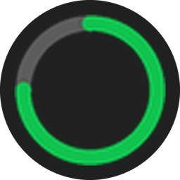
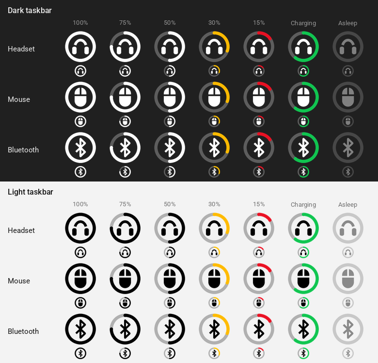
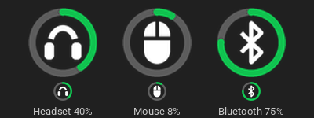

# Halo Battery

**Battery levels of your wireless mouse, keyboard, headset and controller, right in the Windows tray.** 
One icon per device. No vendor software.

### [⬇ Download the latest version](../../releases/latest)

## Features

- **One glance.** A ring for each device fills with its level, turns amber near your alert level and red below it, and breathes green while charging.
- **No vendor apps.** Close Synapse, G HUB, NGENUITY and the rest: Halo Battery talks to the receiver, the cable or Windows Bluetooth itself.
- **30+ brands.** Razer, Logitech, SteelSeries, HyperX, Corsair, ASUS ROG, Sony, Xbox, Nintendo, 8BitDo, Pulsar, Keychron and [many more](docs/devices.md).
- **Stays out of the way.** Alerts wait until your full-screen game closes, and devices are polled less often while you play.
- **Native look.** A Windows 11 style menu, sharp at any display scale, light or dark.
- **Autoupdates.** A new release installs from the tray menu in one click.

## Install

1. Download `HaloBattery-<version>.zip` from the **[latest release](../../releases/latest)**.
2. Extract it to a folder of its own, e.g. `C:\Tools`, and run `HaloBattery\HaloBattery.exe`. Keep the folder together: the .exe needs the `_internal` folder next to it.
3. Right-click a tray icon → **Start with Windows**.

Windows SmartScreen may warn about an unrecognized app, because the file is not code-signed: **More info → Run anyway**. The release is built by GitHub Actions straight from this repository, with public build logs.

Right-click any icon to rename the device, hide it, set its alert level, change the preferences or take a diagnostics report. **[All features and settings →](docs/features.md)** (also: portable mode, running from source)

## Supported devices

Mice, keyboards, headsets and controllers over a 2.4 GHz receiver, a USB cable or Bluetooth.
**[See the full list →](docs/devices.md)** It shows the connection and whether each device has been tested on real hardware.

## Add your device

Is your device not detected, or does it show a wrong level? Send a diagnostics report. It takes about a minute:

1. Close the maker's software (Synapse, G HUB, the web driver and similar) and wake the device up (move the mouse, press a key).
2. Right-click a Halo Battery icon and select **Diagnostics…**. The "No devices found" icon has this item too.

   <picture>
     <source media="(prefers-color-scheme: dark)" srcset="docs/contributing/diagnostics-menu-dark.png">
     
   </picture>

3. The report `diagnostics.txt` opens in Notepad. [Open an issue](../../issues/new?template=device.yml), write the device name and how it is connected (receiver, cable or Bluetooth), and drag the file into the comment box. The file is in `%APPDATA%\HaloBattery`.

The report contains Bluetooth MAC addresses and device serial numbers. You can replace them with `xx` before you post. [CONTRIBUTING.md](.github/CONTRIBUTING.md) explains the report, how to record a USB capture of the maker's app, and how to open a pull request.

<b>Troubleshooting</b>

1. Close Synapse, the WLmouse web driver and other battery tools: they may hold the receiver.
2. Wake the mouse up by moving it.
3. Choose **Diagnostics…** from the tray menu and send the report as [Add your device](#add-your-device) tells you.
4. **"python312.dll was not found"**, or **Start with Windows** says the app runs from a temporary folder: the app was started straight from the ZIP, or only `HaloBattery.exe` was copied out of it. Extract the whole ZIP to a folder of its own and run `HaloBattery.exe` from there.

Settings, the log and the diagnostics report live in `%APPDATA%\HaloBattery` (in the app's own folder in [portable mode](docs/features.md#portable-mode)). The first line of the diagnostics report shows which folder is used.

## Credits

Device protocols come from OpenRazer, HeadsetControl, Solaar, rivalcfg, G-Helper and other open projects, and from captures and test runs sent by the community. **[Full credits →](docs/credits.md)**

MIT licensed, see [LICENSE](LICENSE).
