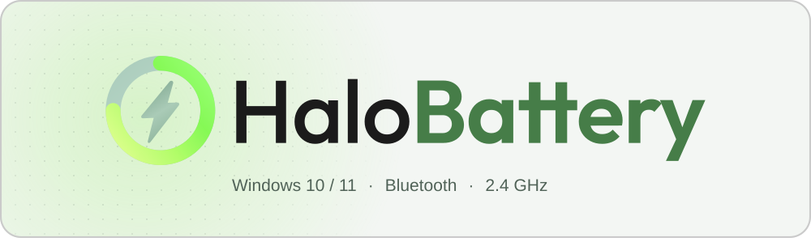
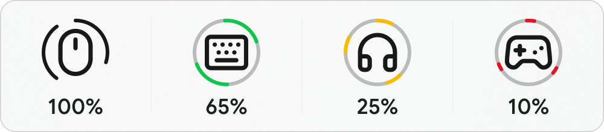
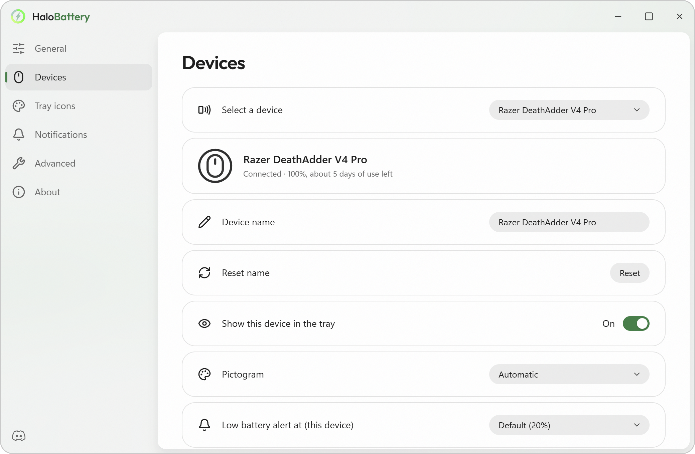
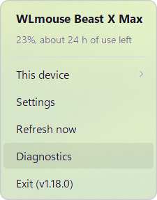

&emsp;<strong>English</strong>&#8202;·&#8202;&#8202;·&#8202;&emsp;<a href="docs/code-signing.md"><picture><source media="(max-width: 440px) and (prefers-color-scheme: dark)" srcset="https://raw.githubusercontent.com/HeyOkay/HaloBattery/docs/readme-download-stats/signpath-compact-dark.svg"><source media="(max-width: 440px) and (prefers-color-scheme: light)" srcset="https://raw.githubusercontent.com/HeyOkay/HaloBattery/docs/readme-download-stats/signpath-compact.svg"><source media="(prefers-color-scheme: dark)" srcset="https://raw.githubusercontent.com/HeyOkay/HaloBattery/docs/readme-download-stats/signpath-dark.svg"><source media="(prefers-color-scheme: light)" srcset="https://raw.githubusercontent.com/HeyOkay/HaloBattery/docs/readme-download-stats/signpath.svg"></picture></a>&nbsp;<a href="https://github.com/HeyOkay/HaloBattery/releases"><picture><source media="(max-width: 440px) and (prefers-color-scheme: dark)" srcset="https://raw.githubusercontent.com/HeyOkay/HaloBattery/docs/readme-download-stats/downloads-compact-dark.svg"><source media="(max-width: 440px) and (prefers-color-scheme: light)" srcset="https://raw.githubusercontent.com/HeyOkay/HaloBattery/docs/readme-download-stats/downloads-compact-light.svg"><source media="(prefers-color-scheme: dark)" srcset="https://raw.githubusercontent.com/HeyOkay/HaloBattery/docs/readme-download-stats/downloads-en-dark.svg"><source media="(prefers-color-scheme: light)" srcset="https://raw.githubusercontent.com/HeyOkay/HaloBattery/docs/readme-download-stats/downloads-en-light.svg"></picture></a>

<picture>
  <source media="(prefers-color-scheme: dark)" srcset="docs/readme/hero-dark.svg">
  <source media="(prefers-color-scheme: light)" srcset="docs/readme/hero-light.svg">
  
</picture>

<h3>See your wireless devices’ battery levels in the Windows tray.</h3>

A ring for your mouse, keyboard, headset and controller, each with its own low-battery alert.

<a href="https://github.com/HeyOkay/HaloBattery/releases/latest"><picture><source media="(prefers-color-scheme: dark)" srcset="docs/readme/buttons/stable-dark.svg"><source media="(prefers-color-scheme: light)" srcset="docs/readme/buttons/stable-light.svg"></picture></a>&ensp; <a href="https://github.com/HeyOkay/HaloBattery/releases"><picture><source media="(prefers-color-scheme: dark)" srcset="docs/readme/buttons/prerelease-dark.svg"><source media="(prefers-color-scheme: light)" srcset="docs/readme/buttons/prerelease-light.svg"></picture></a> 
Windows 10 / 11 · x64 · Installer and portable ZIP

Support project via &nbsp;<a href="https://ko-fi.com/halobattery"><picture><source media="(prefers-color-scheme: dark)" srcset="docs/readme/buttons/ko-fi-dark.svg"><source media="(prefers-color-scheme: light)" srcset="docs/readme/buttons/ko-fi.svg"></picture></a>&ensp; <a href="https://paypal.me/hellobattery"><picture><source media="(prefers-color-scheme: dark)" srcset="docs/readme/buttons/paypal-dark.svg"><source media="(prefers-color-scheme: light)" srcset="docs/readme/buttons/paypal.svg"></picture></a>

<picture>
  <source media="(prefers-color-scheme: dark)" srcset="docs/readme/taskbar-dark.webp">
  <source media="(prefers-color-scheme: light)" srcset="docs/readme/taskbar-light.webp">
  
</picture>

## Features

<picture>
  <source media="(prefers-color-scheme: dark)" srcset="docs/readme/devices-dark.svg">
  <source media="(prefers-color-scheme: light)" srcset="docs/readme/devices-light.svg">
  
</picture>

- **Read the ring.** With a 20% alert threshold, 21–30% is amber and 20% or less is red. Above 30%, the ring follows the tray theme. With charging animation enabled, a known level pulses green. If the device reports charging without a percentage, a green arc rotates.
- **Read the device directly.** Halo Battery checks a 2.4 GHz receiver, a USB cable or Windows Bluetooth. You can close the vendor’s software.
- **Set up each device.** Choose when each device needs attention. By default, alerts wait while a full-screen game is open.

The app supports 11 interface languages. It uses the Windows display language on first launch. You can change it in Settings.

## Device settings

Hover over a tray icon to see the charge and, once enough discharge history is available, the estimated time left. Double-click to open that device in Settings. Give it a recognizable name, choose its pictogram and set the battery level that should trigger an alert.

<picture>
  <source media="(prefers-color-scheme: dark)" srcset="docs/readme/settings-dark.png">
  <source media="(prefers-color-scheme: light)" srcset="docs/readme/settings-light.png">
  
</picture>

## Install

Choose the stable release above, then pick a file under **Assets**. To try upcoming fixes, choose the newest entry marked **Pre-release** in the release list. Test builds may have bugs.

| Package | Getting started |
| --- | --- |
| `HaloBattery-<version>-setup.exe` | Recommended. Run the installer for your Windows account. It adds a Start menu entry and needs no administrator rights. |
| `HaloBattery-<version>.zip` | Extract the entire archive to its own folder. Keep `_internal` beside `HaloBattery.exe`, then launch the executable. |

To verify your download, compare its SHA-256 hash with the entry in `SHA256SUMS.txt` from the same release.

 ·  · 

## Supported devices

Mice, keyboards, headsets and controllers over a 2.4 GHz receiver, a USB cable or Bluetooth.
**** It shows the connection and whether each device has been tested on real hardware.

## Add your device

Is your device not detected, or does it show a wrong level? Send a diagnostics report. It takes about a minute:

1. Close the maker's software (Synapse, G HUB, the web driver and similar) and wake the device up (move the mouse, press a key).
2. Right-click a Halo Battery icon and select **Diagnostics**. The "No devices found" icon has this item too.

   <picture>
     <source media="(prefers-color-scheme: dark)" srcset="docs/contributing/diagnostics-menu-dark.png">
     
   </picture>

3. Halo Battery opens `diagnostics.txt` in your default app for text files. , write the device name and how it is connected (receiver, cable or Bluetooth), and drag the file into the comment box. By default the file is in `%APPDATA%\HaloBattery`. In portable mode it is beside the executable.

The report contains Bluetooth MAC addresses and device serial numbers. You can replace them with `xx` before you post.  explains the report, how to record a USB capture of the maker's app, and how to open a pull request.

<b>Troubleshooting</b>

1. Close Synapse, the WLmouse web driver and other battery tools: they may hold the receiver.
2. Wake the mouse up by moving it.
3. If the battery level still does not appear and the device uses a USB receiver, unplug the receiver and plug it back in.
4. Choose **Diagnostics** from the tray menu and send the report as  tells you.
5. **"python312.dll was not found"**, or **Start with Windows** says the app runs from a temporary folder: the app was started straight from the ZIP, or only `HaloBattery.exe` was copied out of it. Extract the whole ZIP to a folder of its own and run `HaloBattery.exe` from there.

Settings, the log and the diagnostics report live in `%APPDATA%\HaloBattery` (in the app's own folder in ). The `data folder:` line near the top of the diagnostics report shows the active folder.

## Community

 · 

## Credits

Device protocols come from OpenRazer, HeadsetControl, Solaar, rivalcfg, G-Helper and other open projects, and from captures and test runs sent by the community. ****

MIT licensed, see . .

