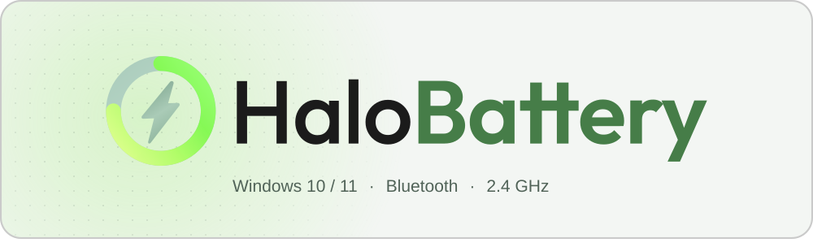
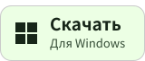
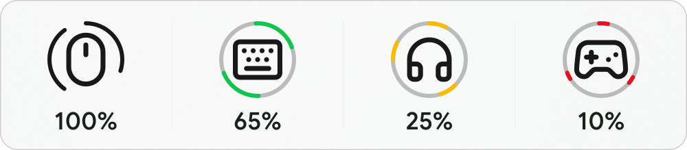
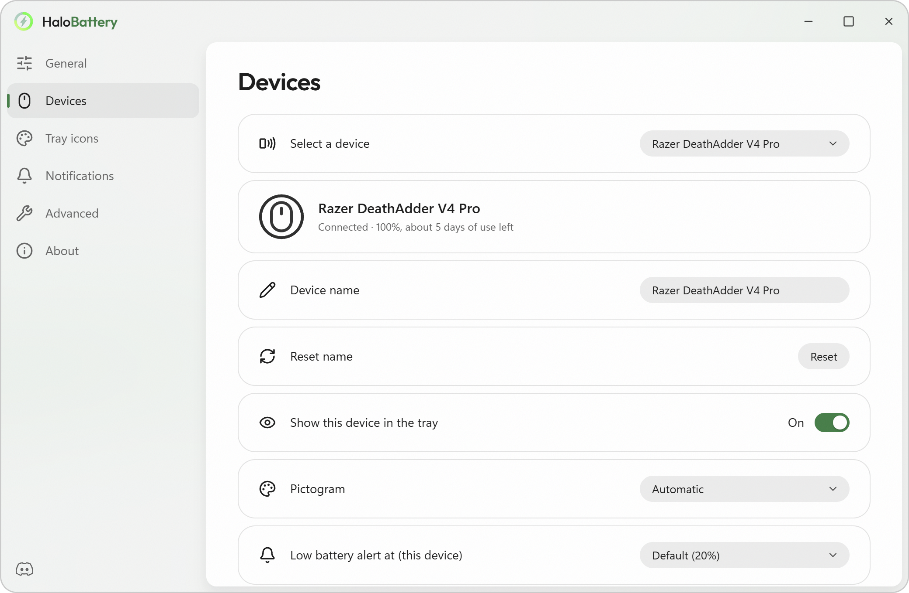
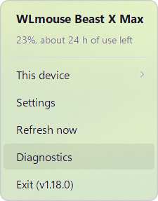

&emsp;&#8202;·&#8202;<strong>Русский</strong>&#8202;·&#8202;&emsp;<a href="docs/code-signing.md"><picture><source media="(max-width: 440px) and (prefers-color-scheme: dark)" srcset="https://raw.githubusercontent.com/HeyOkay/HaloBattery/docs/readme-download-stats/signpath-compact-dark.svg"><source media="(max-width: 440px) and (prefers-color-scheme: light)" srcset="https://raw.githubusercontent.com/HeyOkay/HaloBattery/docs/readme-download-stats/signpath-compact.svg"><source media="(prefers-color-scheme: dark)" srcset="https://raw.githubusercontent.com/HeyOkay/HaloBattery/docs/readme-download-stats/signpath-ru-dark.svg"><source media="(prefers-color-scheme: light)" srcset="https://raw.githubusercontent.com/HeyOkay/HaloBattery/docs/readme-download-stats/signpath-ru.svg"></picture></a>&nbsp;<a href="https://github.com/HeyOkay/HaloBattery/releases"><picture><source media="(max-width: 440px) and (prefers-color-scheme: dark)" srcset="https://raw.githubusercontent.com/HeyOkay/HaloBattery/docs/readme-download-stats/downloads-compact-dark.svg"><source media="(max-width: 440px) and (prefers-color-scheme: light)" srcset="https://raw.githubusercontent.com/HeyOkay/HaloBattery/docs/readme-download-stats/downloads-compact-light.svg"><source media="(prefers-color-scheme: dark)" srcset="https://raw.githubusercontent.com/HeyOkay/HaloBattery/docs/readme-download-stats/downloads-ru-dark.svg"><source media="(prefers-color-scheme: light)" srcset="https://raw.githubusercontent.com/HeyOkay/HaloBattery/docs/readme-download-stats/downloads-ru-light.svg"></picture></a>

<picture>
  <source media="(prefers-color-scheme: dark)" srcset="docs/readme/hero-dark.svg">
  <source media="(prefers-color-scheme: light)" srcset="docs/readme/hero-light.svg">
  
</picture>

<h3>Заряд беспроводных устройств в трее Windows</h3>

У мыши, клавиатуры, гарнитуры и геймпада свой индикатор заряда. Для каждого устройства можно настроить отдельное предупреждение.

<a href="https://github.com/HeyOkay/HaloBattery/releases/latest"><picture><source media="(prefers-color-scheme: dark)" srcset="docs/readme/buttons/stable-ru-dark.svg"><source media="(prefers-color-scheme: light)" srcset="docs/readme/buttons/stable-ru-light.svg"></picture></a>&ensp;<wbr><a href="https://github.com/HeyOkay/HaloBattery/releases"><picture><source media="(prefers-color-scheme: dark)" srcset="docs/readme/buttons/prerelease-ru-dark.svg"><source media="(prefers-color-scheme: light)" srcset="docs/readme/buttons/prerelease-ru-light.svg"></picture></a> 
Windows 10 / 11 · x64 · Установщик и портативный ZIP-архив

Поддержать проект через &nbsp;<a href="https://ko-fi.com/halobattery"><picture><source media="(prefers-color-scheme: dark)" srcset="docs/readme/buttons/ko-fi-dark.svg"><source media="(prefers-color-scheme: light)" srcset="docs/readme/buttons/ko-fi.svg"></picture></a>&ensp;<wbr><a href="https://paypal.me/hellobattery"><picture><source media="(prefers-color-scheme: dark)" srcset="docs/readme/buttons/paypal-dark.svg"><source media="(prefers-color-scheme: light)" srcset="docs/readme/buttons/paypal.svg"></picture></a>

<picture>
  <source media="(prefers-color-scheme: dark)" srcset="docs/readme/taskbar-dark.webp">
  <source media="(prefers-color-scheme: light)" srcset="docs/readme/taskbar-light.webp">
  
</picture>

## Возможности

<picture>
  <source media="(prefers-color-scheme: dark)" srcset="docs/readme/devices-dark.svg">
  <source media="(prefers-color-scheme: light)" srcset="docs/readme/devices-light.svg">
  
</picture>

- **Заряд виден по кольцу.** Если порог предупреждения задан на 20%, при заряде 21–30% кольцо становится янтарным, а при 20% и ниже — красным. Выше 30% цвет зависит от темы трея. Если включена анимация зарядки, кольцо пульсирует зелёным. Если устройство сообщает о зарядке без указания процентов, вместо кольца вращается зелёная дуга.
- **Данные поступают с устройства.** Halo Battery считывает заряд через приёмник 2,4 ГГц, USB-кабель или Bluetooth в Windows. Фирменную программу производителя можно закрыть.
- **Уведомления настраиваются отдельно.** Выберите, при каком заряде напоминать о каждом устройстве. По умолчанию приложение откладывает уведомления до выхода из полноэкранной игры.

Интерфейс приложения доступен на 11 языках. При первом запуске язык выбирается по настройкам Windows. Его можно изменить в настройках приложения.

## Настройки устройств

Наведите указатель на значок в трее, чтобы узнать заряд. Когда накопится история разряда, в подсказке появится прогноз оставшегося времени работы. Дважды щёлкните по значку, чтобы открыть настройки устройства. Там можно изменить имя, выбрать пиктограмму и задать порог предупреждения о низком заряде.

<picture>
  <source media="(prefers-color-scheme: dark)" srcset="docs/readme/settings-dark.png">
  <source media="(prefers-color-scheme: light)" srcset="docs/readme/settings-light.png">
  
</picture>

## Установка

Нажмите «Скачать» вверху страницы и выберите файл в разделе **Assets** на GitHub. Чтобы попробовать исправления до выпуска стабильной версии, откройте список предрелизов и выберите последний с пометкой **Pre-release**. В тестовых сборках возможны ошибки.

| Файл | Как установить |
| --- | --- |
| `HaloBattery-<version>-setup.exe` | Рекомендуемый вариант. Запустите установщик. Он установит приложение для вашей учётной записи и добавит ярлык в меню «Пуск». Права администратора не требуются. |
| `HaloBattery-<version>.zip` | Распакуйте весь архив в отдельную папку и запустите `HaloBattery.exe`. Папка `_internal` должна лежать рядом с ним. |

Чтобы проверить скачанный файл, сравните его хеш SHA-256 со значением в `SHA256SUMS.txt` из того же выпуска.

 ·  · 

## Поддерживаемые устройства

Halo Battery поддерживает мыши, клавиатуры, гарнитуры и геймпады с подключением через приёмник 2,4 ГГц, USB-кабель или Bluetooth. В таблице указаны способ подключения и результаты проверки на реальном устройстве.

## Как добавить устройство

Если приложение не видит устройство или показывает неверный заряд, отправьте диагностический отчёт. Это займёт около минуты.

1. Закройте программу производителя (например, Synapse, G HUB или веб-драйвер) и разбудите устройство движением мыши или нажатием клавиши.
2. Щёлкните правой кнопкой мыши по значку Halo Battery в трее и выберите **«Диагностика…»**. Этот пункт есть и в меню значка «Устройства не найдены».

   <picture>
     <source media="(prefers-color-scheme: dark)" srcset="docs/contributing/diagnostics-menu-dark.png">
     
   </picture>

3. Halo Battery откроет `diagnostics.txt` в вашем редакторе текстовых файлов. , укажите модель и способ подключения (приёмник, кабель или Bluetooth), затем перетащите файл в поле комментария. По умолчанию отчёт сохраняется в `%APPDATA%\HaloBattery`, а в портативном режиме — рядом с исполняемым файлом.

В отчёте есть MAC-адреса Bluetooth и серийные номера устройств. Перед публикацией их можно заменить на `xx`. В  описано, как читать отчёт, записать USB-обмен программы производителя и предложить изменения через pull request.

<b>Устранение неполадок</b>

1. Закройте Synapse, веб-драйвер WLmouse и другие программы мониторинга заряда. Они могут занимать приёмник.
2. Подвигайте мышью, чтобы разбудить её.
3. Если заряд по-прежнему не отображается и устройство подключено через USB-приёмник, попробуйте вынуть приёмник из USB-порта и подключить его снова.
4. Если это не помогло, выберите **«Диагностика…»** в меню значка и отправьте отчёт, как описано в разделе .
5. Если Windows сообщает об отсутствии `python312.dll` или при включении «Запускать вместе с Windows» появляется сообщение о временной папке, распакуйте **весь** ZIP-архив в отдельную папку и запустите оттуда `HaloBattery.exe`. Такая ошибка возникает при запуске прямо из архива или после извлечения только исполняемого файла.

Настройки, журнал и отчёт хранятся в `%APPDATA%\HaloBattery`. В портативном режиме они находятся в папке приложения. Путь к используемой папке указан в строке `data folder:` в начале отчёта.

## Сообщество

 · 

## Благодарности

При реализации протоколов использованы материалы OpenRazer, HeadsetControl, Solaar, rivalcfg, G-Helper и других открытых проектов, а также записи обмена данными и результаты тестов, которыми поделились пользователи. 

Лицензия MIT.  ·  · 
