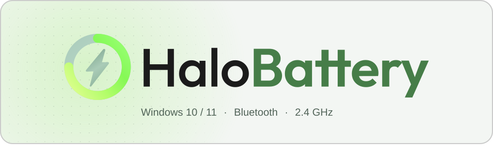
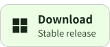
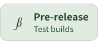
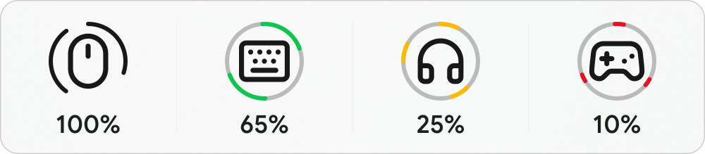
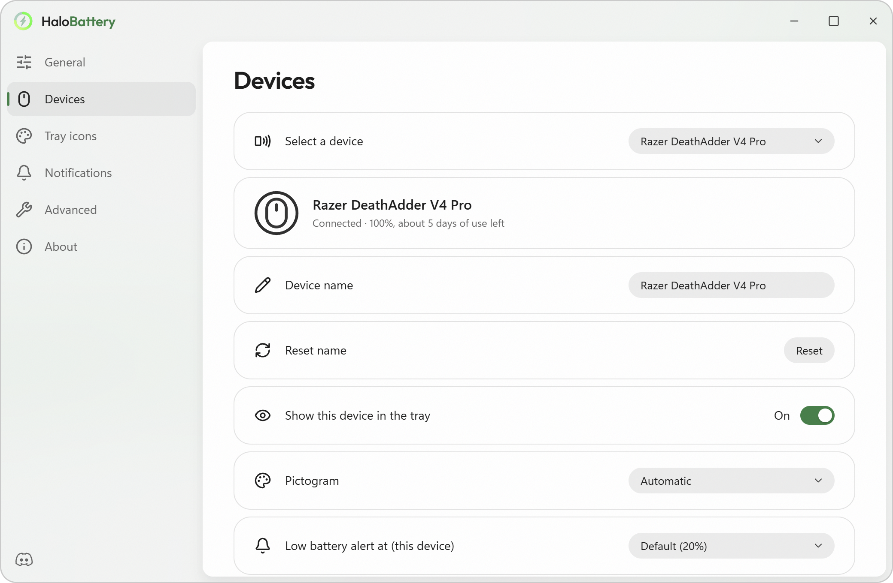
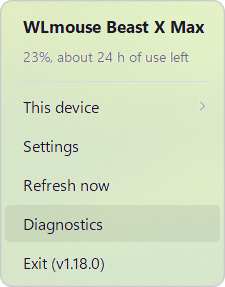

&emsp;&#8202;·&#8202;&#8202;·&#8202;&#8202;·&#8202;<strong>Türkçe</strong>&emsp;<a href="docs/code-signing.md"><picture><source media="(max-width: 440px) and (prefers-color-scheme: dark)" srcset="https://raw.githubusercontent.com/HeyOkay/HaloBattery/docs/readme-download-stats/signpath-compact-dark.svg"><source media="(max-width: 440px) and (prefers-color-scheme: light)" srcset="https://raw.githubusercontent.com/HeyOkay/HaloBattery/docs/readme-download-stats/signpath-compact.svg"><source media="(prefers-color-scheme: dark)" srcset="https://raw.githubusercontent.com/HeyOkay/HaloBattery/docs/readme-download-stats/signpath-dark.svg"><source media="(prefers-color-scheme: light)" srcset="https://raw.githubusercontent.com/HeyOkay/HaloBattery/docs/readme-download-stats/signpath.svg"></picture></a>&nbsp;<a href="https://github.com/HeyOkay/HaloBattery/releases"><picture><source media="(max-width: 440px) and (prefers-color-scheme: dark)" srcset="https://raw.githubusercontent.com/HeyOkay/HaloBattery/docs/readme-download-stats/downloads-compact-dark.svg"><source media="(max-width: 440px) and (prefers-color-scheme: light)" srcset="https://raw.githubusercontent.com/HeyOkay/HaloBattery/docs/readme-download-stats/downloads-compact-light.svg"><source media="(prefers-color-scheme: dark)" srcset="https://raw.githubusercontent.com/HeyOkay/HaloBattery/docs/readme-download-stats/downloads-en-dark.svg"><source media="(prefers-color-scheme: light)" srcset="https://raw.githubusercontent.com/HeyOkay/HaloBattery/docs/readme-download-stats/downloads-en-light.svg"></picture></a>

<picture>
  <source media="(prefers-color-scheme: dark)" srcset="docs/readme/hero-dark.svg">
  <source media="(prefers-color-scheme: light)" srcset="docs/readme/hero-light.svg">
  
</picture>

<h3>Kablosuz cihazlarınızın pil seviyelerini Windows sistem tepsisinde görün.</h3>

Fareniz, klavyeniz, kulaklığınız ve oyun kumandanız için her birine özel düşük pil uyarısıyla ayrı birer halka.

<a href="https://github.com/HeyOkay/HaloBattery/releases/latest"><picture><source media="(prefers-color-scheme: dark)" srcset="docs/readme/buttons/stable-dark.svg"><source media="(prefers-color-scheme: light)" srcset="docs/readme/buttons/stable-light.svg"></picture></a>&ensp;<wbr><a href="https://github.com/HeyOkay/HaloBattery/releases"><picture><source media="(prefers-color-scheme: dark)" srcset="docs/readme/buttons/prerelease-dark.svg"><source media="(prefers-color-scheme: light)" srcset="docs/readme/buttons/prerelease-light.svg"></picture></a> 
Windows 10 / 11 · x64 · Yükleyici ve taşınabilir ZIP

Projeyi destekle: &nbsp;<a href="https://ko-fi.com/halobattery"><picture><source media="(prefers-color-scheme: dark)" srcset="docs/readme/buttons/ko-fi-dark.svg"><source media="(prefers-color-scheme: light)" srcset="docs/readme/buttons/ko-fi.svg"></picture></a>&ensp;<wbr><a href="https://paypal.me/hellobattery"><picture><source media="(prefers-color-scheme: dark)" srcset="docs/readme/buttons/paypal-dark.svg"><source media="(prefers-color-scheme: light)" srcset="docs/readme/buttons/paypal.svg"></picture></a>

<picture>
  <source media="(prefers-color-scheme: dark)" srcset="docs/readme/taskbar-dark.webp">
  <source media="(prefers-color-scheme: light)" srcset="docs/readme/taskbar-light.webp">
  
</picture>

## Özellikler

<picture>
  <source media="(prefers-color-scheme: dark)" srcset="docs/readme/devices-dark.svg">
  <source media="(prefers-color-scheme: light)" srcset="docs/readme/devices-light.svg">
  
</picture>

- **Halkayı okuyun.** %20 uyarı eşiğiyle %21–30 sarı, %20 ve altı kırmızı görünür. %30'un üzerinde halka sistem tepsisi temasını izler. Şarj animasyonu etkinken bilinen bir seviye yeşil olarak yanıp söner; cihaz yüzde bildirmeden şarj olduğunu bildirirse yeşil bir yay döner.
- **Cihazı doğrudan okuyun.** Halo Battery; 2.4 GHz alıcıyı, USB kablosunu veya Windows Bluetooth bağlantısını doğrudan okur. Üreticinin yazılımını kapatabilirsiniz.
- **Her cihazı ayrı ayarlayın.** Her cihazın ne zaman uyarı vereceğini seçin. Varsayılan olarak tam ekran bir oyun açıkken uyarılar bekletilir.

Uygulama 11 arayüz dilini destekler. İlk açılışta Windows görüntüleme dilini kullanır; Ayarlar'dan değiştirebilirsiniz.

## Cihaz ayarları

Şarj düzeyini ve yeterli deşarj geçmişi biriktiğinde tahmini kalan süreyi görmek için tepsi simgesinin üzerine gelin. İlgili cihazı Ayarlar'da açmak için çift tıklayın; kolay tanınan bir ad verin, simgesini seçin ve uyarı tetikleyecek pil seviyesini belirleyin.

<picture>
  <source media="(prefers-color-scheme: dark)" srcset="docs/readme/settings-dark.png">
  <source media="(prefers-color-scheme: light)" srcset="docs/readme/settings-light.png">
  
</picture>

## Kurulum

Yukarıdan kararlı sürümü seçin, ardından **Assets** altından bir dosya indirin. Yaklaşan düzeltmeleri denemek için sürüm listesinde **Pre-release** olarak işaretlenen en yeni sürümü seçebilirsiniz (test derlemelerinde hatalar olabilir).

| Paket | Başlangıç |
| --- | --- |
| `HaloBattery-<version>-setup.exe` | Önerilen. Yükleyiciyi Windows hesabınız için çalıştırın. Başlat menüsü girişi ekler ve yönetici izni gerektirmez. |
| `HaloBattery-<version>.zip` | Tüm arşivi kendi klasörüne çıkarın. `_internal` klasörünü `HaloBattery.exe` yanında tutun ve uygulamayı çalıştırın. |

İndirdiğiniz dosyayı doğrulamak için SHA-256 özetini aynı sürümdeki `SHA256SUMS.txt` dosyasıyla karşılaştırabilirsiniz.

[Özellikler ve ayarlar](docs/features.md) · [Taşınabilir mod](docs/features.md#portable-mode) · [Kaynak koddan çalıştır](docs/features.md#run-from-source)

## Desteklenen cihazlar

2.4 GHz alıcı, USB kablosu veya Bluetooth üzerinden fareler, klavyeler, kulaklıklar ve oyun kumandaları.
**[Tam listeyi görün →](docs/devices.md)** Her cihazın bağlantı türünü ve gerçek donanımda test edilip edilmediğini gösterir.

## Cihazınızı ekleyin

Cihazınız algılanmıyor mu veya yanlış pil seviyesi mi gösteriyor? Yaklaşık bir dakikanızı alacak bir tanılama raporu gönderin:

1. Üreticinin yazılımını kapatın (Synapse, G HUB, web sürücüsü vb.) ve cihazı uyandırın (fareyi hareket ettirin, bir tuşa basın).
2. Bir Halo Battery simgesine sağ tıklayıp **Diagnostics** (Tanılama) seçeneğini seçin ("Cihaz bulunamadı" simgesinde de bu seçenek vardır).

   <picture>
     <source media="(prefers-color-scheme: dark)" srcset="docs/contributing/diagnostics-menu-dark.png">
     
   </picture>

3. Halo Battery `diagnostics.txt` dosyasını varsayılan metin düzenleyicinizde açar. [Bir issue açın](../../issues/new?template=device.yml), cihazın adını ve nasıl bağlandığını (alıcı, kablo veya Bluetooth) yazın ve dosyayı yorum kutusuna sürükleyin. Dosya varsayılan olarak `%APPDATA%\HaloBattery` klasöründedir (taşınabilir modda uygulamanın yanındadır).

Rapor Bluetooth MAC adreslerini ve cihaz seri numaralarını içerir; göndermeden önce bunları `xx` ile değiştirebilirsiniz. [CONTRIBUTING.md](.github/CONTRIBUTING.md) dosyası raporu, üretici uygulamasından USB yakalamasının nasıl kaydedileceğini ve nasıl pull request açılacağını açıklar.

<b>Sorun Giderme</b>

1. Synapse, WLmouse web sürücüsü ve diğer pil araçlarını kapatın; alıcıyı meşgul edebilirler.
2. Fareyi hareket ettirerek uyandırın.
3. Pil seviyesi hâlâ görünmüyorsa ve cihaz USB alıcı kullanıyorsa alıcıyı çıkarıp yeniden takın.
4. Tepsi menüsünden **Diagnostics** seçeneğini seçin ve raporu [Cihazınızı ekleyin](#cihaz%C4%B1n%C4%B1z%C4%B1-ekleyin) bölümünde anlatıldığı gibi gönderin.
5. **"python312.dll was not found"** hatası alıyorsanız veya **Windows ile başlat** uygulamanın geçici klasörden çalıştığını söylüyorsa: uygulama doğrudan ZIP içinden çalıştırılmış veya yalnızca `HaloBattery.exe` kopyalanmıştır. Tüm ZIP arşivini ayrı bir klasöre çıkarıp `HaloBattery.exe` dosyasını oradan çalıştırın.

Ayarlar, günlük dosyası ve tanılama raporu `%APPDATA%\HaloBattery` konumunda tutulur ([taşınabilir modda](docs/features.md#portable-mode) uygulamanın kendi klasöründe). Tanılama raporunun başındaki `data folder:` satırı etkin klasörü gösterir.

## Topluluk

[Projeye katkıda bulun](.github/CONTRIBUTING.md) · [Discord topluluğuna katıl](https://discord.gg/K796KR9xtk)

## Teşekkürler

Cihaz protokolleri OpenRazer, HeadsetControl, Solaar, rivalcfg, G-Helper ve diğer açık kaynak projelerden, ayrıca topluluk tarafından gönderilen yakalama ve testlerden yararlanılarak geliştirilmiştir. **[Tam teşekkür listesi →](docs/credits.md)**

MIT lisanslıdır; bkz. [LICENSE](LICENSE) · [Kod imzalama politikası](docs/code-signing.md).

[Gizlilik](docs/privacy.md)
