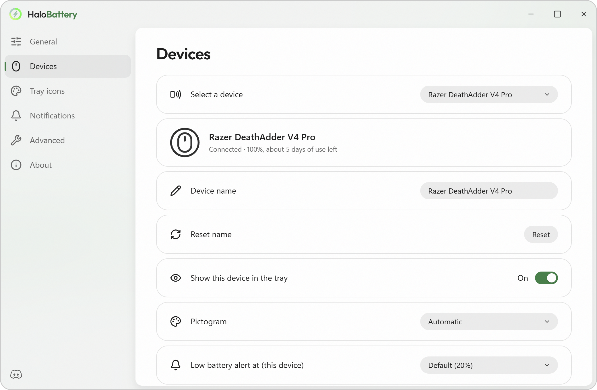

&emsp;&#8202;·&#8202;&#8202;·&#8202;<strong>简体中文</strong>&#8202;·&#8202;&emsp;<a href="docs/code-signing.md"><picture><source media="(max-width: 440px) and (prefers-color-scheme: dark)" srcset="https://raw.githubusercontent.com/HeyOkay/HaloBattery/docs/readme-download-stats/signpath-compact-dark.svg"><source media="(max-width: 440px) and (prefers-color-scheme: light)" srcset="https://raw.githubusercontent.com/HeyOkay/HaloBattery/docs/readme-download-stats/signpath-compact.svg"><source media="(prefers-color-scheme: dark)" srcset="https://raw.githubusercontent.com/HeyOkay/HaloBattery/docs/readme-download-stats/signpath-zh-dark.svg"><source media="(prefers-color-scheme: light)" srcset="https://raw.githubusercontent.com/HeyOkay/HaloBattery/docs/readme-download-stats/signpath-zh.svg"></picture></a>&nbsp;<a href="https://github.com/HeyOkay/HaloBattery/releases" title="下载量"><picture><source media="(max-width: 440px) and (prefers-color-scheme: dark)" srcset="https://raw.githubusercontent.com/HeyOkay/HaloBattery/docs/readme-download-stats/downloads-compact-dark.svg?v=2"><source media="(max-width: 440px) and (prefers-color-scheme: light)" srcset="https://raw.githubusercontent.com/HeyOkay/HaloBattery/docs/readme-download-stats/downloads-compact-light.svg?v=2"><source media="(prefers-color-scheme: dark)" srcset="https://raw.githubusercontent.com/HeyOkay/HaloBattery/docs/readme-download-stats/downloads-zh-dark.svg?v=2"><source media="(prefers-color-scheme: light)" srcset="https://raw.githubusercontent.com/HeyOkay/HaloBattery/docs/readme-download-stats/downloads-zh-light.svg?v=2"></picture></a>

<picture>
  <source media="(prefers-color-scheme: dark)" srcset="docs/readme/hero-dark.svg">
  <source media="(prefers-color-scheme: light)" srcset="docs/readme/hero-light.svg">
  
</picture>

<h3>在 Windows 托盘中查看无线设备的电量。</h3>

鼠标、键盘、耳机和手柄各有一个电量环。

<a href="https://github.com/HeyOkay/HaloBattery/releases/latest"><picture><source media="(prefers-color-scheme: dark)" srcset="docs/readme/buttons/stable-zh-dark.svg"><source media="(prefers-color-scheme: light)" srcset="docs/readme/buttons/stable-zh-light.svg"></picture></a>&ensp; <a href="https://github.com/HeyOkay/HaloBattery/releases"><picture><source media="(prefers-color-scheme: dark)" srcset="docs/readme/buttons/prerelease-zh-dark.svg"><source media="(prefers-color-scheme: light)" srcset="docs/readme/buttons/prerelease-zh-light.svg"></picture></a> 
Windows 10 / 11 · x64 · 提供安装程序和便携 ZIP 包

通过以下方式支持项目 &nbsp;<a href="https://ko-fi.com/halobattery"><picture><source media="(prefers-color-scheme: dark)" srcset="docs/readme/buttons/ko-fi-dark.svg"><source media="(prefers-color-scheme: light)" srcset="docs/readme/buttons/ko-fi.svg"></picture></a>&ensp; <a href="https://paypal.me/hellobattery"><picture><source media="(prefers-color-scheme: dark)" srcset="docs/readme/buttons/paypal-dark.svg"><source media="(prefers-color-scheme: light)" srcset="docs/readme/buttons/paypal.svg"></picture></a>

<picture>
  <source media="(prefers-color-scheme: dark)" srcset="docs/readme/taskbar-dark.webp">
  <source media="(prefers-color-scheme: light)" srcset="docs/readme/taskbar-light.webp">
  
</picture>

## 功能

<picture>
  <source media="(prefers-color-scheme: dark)" srcset="docs/readme/devices-dark.svg">
  <source media="(prefers-color-scheme: light)" srcset="docs/readme/devices-light.svg">
  
</picture>

- **看懂电量环。** 当提醒阈值设为 20% 时，21–30% 显示为琥珀色，20% 及以下显示为红色。高于 30% 时，圆环颜色随托盘主题变化。启用充电动画后，如果设备报告电量百分比，绿色圆环会呈呼吸效果；如果只报告正在充电，则会显示旋转的绿色圆弧。
- **直接读取设备。** Halo Battery 通过 2.4 GHz 接收器、USB 数据线或 Windows 蓝牙读取电量，无需运行厂商软件。
- **按设备设置。** 每台设备均可单独设置提醒阈值。默认在全屏游戏期间暂缓提醒。

应用界面支持 11 种语言。首次启动时会采用 Windows 显示语言，之后可以在设置中更改。

## 设备设置

将鼠标悬停在托盘图标上可查看电量。积累足够的放电记录后，还会显示预计剩余使用时间。双击图标可直接打开该设备的设置。在这里可以更改显示名称、选择图标，并调整低电量提醒。

<picture>
  <source media="(prefers-color-scheme: dark)" srcset="docs/readme/settings-dark.png">
  <source media="(prefers-color-scheme: light)" srcset="docs/readme/settings-light.png">
  
</picture>

## 安装

在上方选择稳定版，然后在发布页的 **Assets** 中选择一个文件。要试用新修复，请在版本列表中选择最新的 **Pre-release**。测试版本可能存在问题。

| 文件 | 使用方法 |
| --- | --- |
| `HaloBattery-<version>-setup.exe` | 推荐。运行安装程序即可为当前用户安装，无需管理员权限，并会添加开始菜单项。 |
| `HaloBattery-<version>.zip` | 将整个压缩包解压到单独的文件夹，保留 `_internal` 文件夹，然后运行 `HaloBattery.exe`。 |

如需验证下载文件，请将其 SHA-256 哈希值与同一发布页中 `SHA256SUMS.txt` 的对应条目进行比较。

 ·  · 

## 支持的设备

支持通过 2.4 GHz 接收器、USB 数据线或蓝牙连接的鼠标、键盘、耳机和手柄。
**** 列表中标明了连接方式，以及各设备是否经过真实硬件测试。

## 添加你的设备

设备未被识别，或电量显示有误？请发送诊断报告，大约需要一分钟：

1. 关闭厂商软件（Synapse、G HUB、网页驱动等），并唤醒设备，例如移动鼠标或按下按键。
2. 右键 Halo Battery 托盘图标，选择**诊断**。“未找到设备”的图标中也有这一项。

   <picture>
     <source media="(prefers-color-scheme: dark)" srcset="docs/contributing/diagnostics-menu-dark.png">
     
   </picture>

3. Halo Battery 会使用默认文本应用打开 `diagnostics.txt`。，说明设备名称和连接方式（接收器、USB 数据线或蓝牙），并将文件拖入评论框。默认保存在 `%APPDATA%\HaloBattery`。启用便携模式时，文件保存在可执行文件旁。

报告包含蓝牙 MAC 地址和设备序列号，发布前可以将它们替换为 `xx`。介绍了报告内容、如何录制厂商软件的 USB 抓包，以及如何提交 pull request。

<b>疑难解答</b>

1. 关闭 Synapse、WLmouse 网页驱动和其他电量工具，它们可能占用接收器。
2. 移动鼠标以唤醒设备。
3. 如果设备使用 USB 接收器，但仍不显示电量，请拔下接收器再重新插入。
4. 在托盘菜单中选择**诊断**，按照中的说明发送报告。
5. **提示“python312.dll was not found”**，或**开机启动**提示程序正在临时文件夹中运行：程序可能直接从 ZIP 中启动，或仅复制了 `HaloBattery.exe`。请将整个 ZIP 解压到独立文件夹，再从中运行 `HaloBattery.exe`。

设置、日志和诊断报告位于 `%APPDATA%\HaloBattery`（下位于程序自己的文件夹）。诊断报告开头的 `data folder:` 行会显示实际使用的文件夹。

## 社区

 · 

## 致谢

设备协议来自 OpenRazer、HeadsetControl、Solaar、rivalcfg、G-Helper 等开源项目，以及社区提供的抓包和测试记录。****

本项目采用 MIT 许可证，详见 。

 · 
