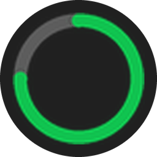
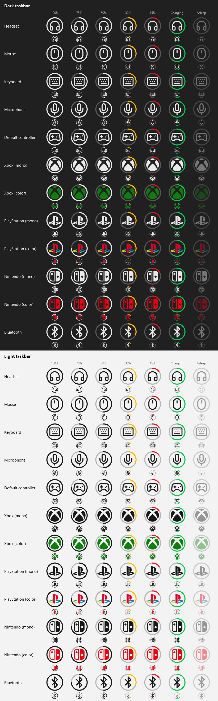
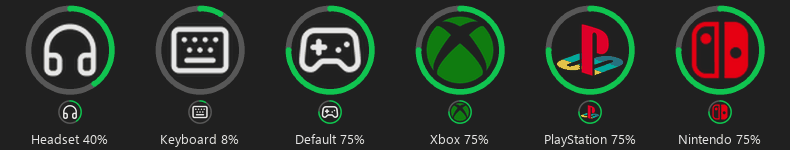
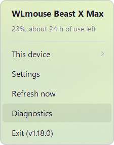

# Halo Battery

**在 Windows 系统托盘中查看无线鼠标、键盘、耳机和手柄的电量。** 
每个设备一个图标，无需厂商软件。

### [⬇ 下载最新版本](../../releases/latest)

本项目由维护者和社区共同维护。参与贡献请阅读[贡献指南](.github/CONTRIBUTING.md)。 
[预发布版本](https://github.com/HeyOkay/HaloBattery/releases)包含尚未正式发布的修复，可能存在问题。请选择最新标记为 **Pre-release** 的版本；每次成功构建都有独立的发布版本和对应的源码标签。

[English](README.md) | **简体中文**

## 功能

- **一眼看清电量。** 每个设备的圆环按电量填充，接近提醒阈值时变为琥珀色，低于阈值时变红，充电时呈绿色呼吸效果。
- **无需厂商软件。** 可以关闭 Synapse、G HUB、NGENUITY 等软件：Halo Battery 直接通过接收器、USB 数据线或 Windows 蓝牙读取电量。
- **支持 30 多个品牌。** 包括雷蛇、罗技、赛睿、HyperX、海盗船、华硕 ROG、索尼、Xbox、任天堂、8BitDo、Pulsar、Keychron [以及更多](docs/devices.md)。
- **减少打扰。** 全屏游戏期间暂缓提醒，并降低设备轮询频率。
- **原生外观。** Windows 11 风格菜单，适配不同显示缩放比例，支持浅色和深色主题。
- **自动更新。** 在托盘菜单中一键安装新版本。
- **九种界面语言。** 支持英语、西班牙语、法语、日语、哈萨克语、乌克兰语、俄语、简体中文和繁体中文。首次启动时根据 Windows 显示语言选择，也可在首选项中切换。

## 安装

**安装程序（推荐）：** 从**[最新发布](../../releases/latest)**下载 `HaloBattery-<version>-setup.exe` 并运行。无需管理员权限，仅为当前用户安装，会添加开始菜单快捷方式，并可设置随 Windows 启动。卸载时打开 **设置 → 应用**。

**便携 ZIP 包：** 下载 `HaloBattery-<version>.zip`，解压到独立文件夹（例如 `C:\Tools`），然后运行 `HaloBattery\HaloBattery.exe`。请保留完整文件夹：程序需要旁边的 `_internal` 文件夹。右键托盘图标可设置**开机启动**。

由于程序尚未进行代码签名，Windows SmartScreen 可能会提示应用无法识别：选择**更多信息 → 仍要运行**。发布版本由 GitHub Actions 直接从本仓库构建，构建日志公开。

右键任意图标可以重命名或隐藏设备、设置提醒阈值、修改首选项或生成诊断报告。**[全部功能与设置 →](docs/features.md)**（另有便携模式和从源码运行的说明）

## 支持的设备

支持通过 2.4 GHz 接收器、USB 数据线或蓝牙连接的鼠标、键盘、耳机和手柄。
**[查看完整列表 →](docs/devices.md)** 列表中标明了连接方式，以及各设备是否经过真实硬件测试。

## 添加你的设备

设备未被识别，或电量显示有误？请发送诊断报告，大约需要一分钟：

1. 关闭厂商软件（Synapse、G HUB、网页驱动等），并唤醒设备，例如移动鼠标或按下按键。
2. 右键 Halo Battery 托盘图标，选择**诊断…**。“未找到设备”的图标中也有这一项。

   <picture>
     <source media="(prefers-color-scheme: dark)" srcset="docs/contributing/diagnostics-menu-dark.png">
     
   </picture>

3. 记事本会打开 `diagnostics.txt`。[提交 issue](../../issues/new?template=device.yml)，说明设备名称和连接方式（接收器、USB 数据线或蓝牙），并将文件拖入评论框。文件位于 `%APPDATA%\HaloBattery`。

报告包含蓝牙 MAC 地址和设备序列号，发布前可以将它们替换为 `xx`。[贡献指南](.github/CONTRIBUTING.md)介绍了报告内容、如何录制厂商软件的 USB 抓包，以及如何提交 pull request。

<b>疑难解答</b>

1. 关闭 Synapse、WLmouse 网页驱动和其他电量工具，它们可能占用接收器。
2. 移动鼠标以唤醒设备。
3. 在托盘菜单中选择**诊断…**，按照[添加你的设备](#添加你的设备)中的说明发送报告。
4. **提示“python312.dll was not found”**，或**开机启动**提示程序正在临时文件夹中运行：程序可能直接从 ZIP 中启动，或仅复制了 `HaloBattery.exe`。请将整个 ZIP 解压到独立文件夹，再从中运行 `HaloBattery.exe`。

设置、日志和诊断报告位于 `%APPDATA%\HaloBattery`（[便携模式](docs/features.md#portable-mode)下位于程序自己的文件夹）。诊断报告的第一行会显示实际使用的文件夹。

## 致谢

设备协议来自 OpenRazer、HeadsetControl、Solaar、rivalcfg、G-Helper 等开源项目，以及社区提供的抓包和测试记录。**[完整致谢 →](docs/credits.md)**

本项目采用 MIT 许可证，详见 [LICENSE](LICENSE)。

[隐私说明](docs/privacy.md) · [代码签名政策](docs/code-signing.md)
